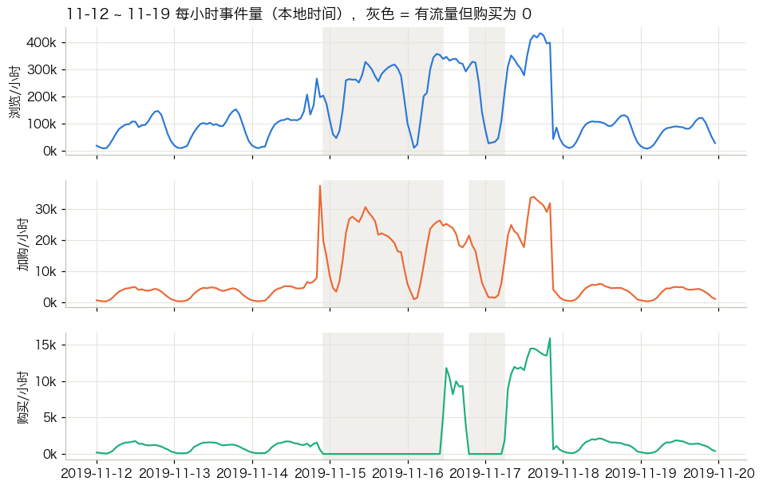
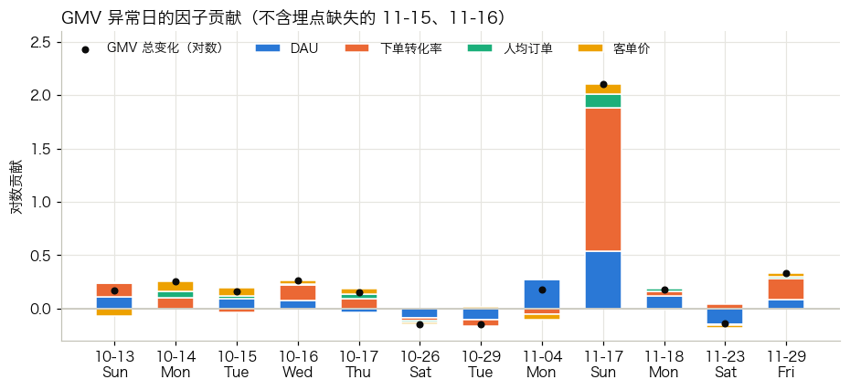
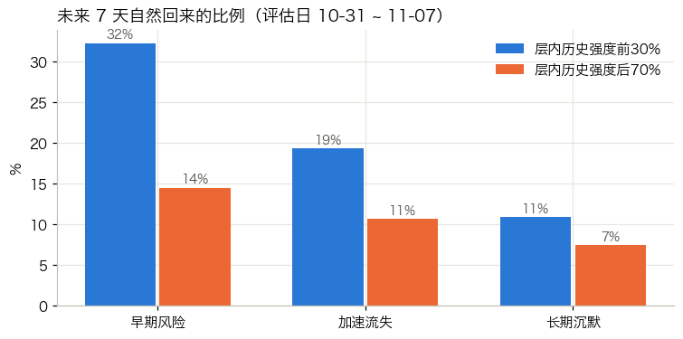
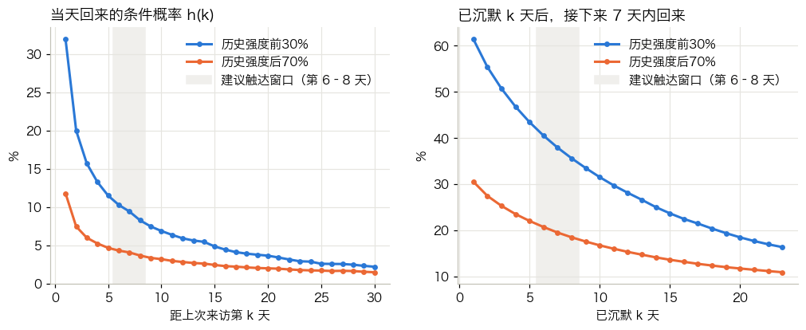

# 电商用户生命周期分析：从行为日志到召回策略

个人项目 · 2026.01 – 2026.03 · 海外多品类电商平台 · 1.1 亿条用户行为数据、530 万用户

**[指标看板](https://siruitan920.github.io/ecommerce-lifecycle-analytics/)**　·　[分析报告（7 篇）](#分析报告)　·　[指标口径](docs/metrics_system.md)　·　[数据质量报告](docs/data_quality_report.md)　·　[A/B 实验方案](docs/ab_test_plan.md)

---

## 执行摘要

**背景**：平台以手机等 3C 电子产品为主，低频、高客单价。截至观察期末（2019-11-30），73% 的用户已经超过一周没有访问，
召回存量用户的空间远大于拉新。

**要回答的问题**：哪些沉默用户值得召回？什么时候召回？召回一个用户值多少钱？怎样验证召回有效？

**结论与建议**

| | 结论 | 建议 | 依据 |
|---|---|---|---|
| 召回谁 | 「早期风险 × 高强度」用户（沉默 8–14 天、历史行为前 30%）7 天自然回流率 32%，同层其余用户仅 14.5%；此类高价值风险用户约 74 万人 | 召回优先级：早期风险 × 高强度 → 加速流失 × 高强度 → 其余 | [报告 03](notebooks/03_lifecycle_segmentation.ipynb)、[04](notebooks/04_return_prediction_and_timing.ipynb) |
| 何时召回 | 高强度用户沉默 6 天后，自然回流概率趋于平稳 | 在沉默第 6–8 天触达；大促后第 6–8 天对大促期间到访的老用户补充触达 | [报告 04](notebooks/04_return_prediction_and_timing.ipynb)、[06](notebooks/06_campaign_review.ipynb) |
| 怎么召回 | 每触达一人的增量 GMV 仅 3–6（原始价格单位）；流失多因需求周期中断，而非货品不匹配 | 优先使用 Push、站内信等低成本渠道，内容用用户原兴趣品类的降价/新品；发券需以实测效果核算 | [报告 03](notebooks/03_lifecycle_segmentation.ipynb)、[05](notebooks/05_value_and_ab_test_design.ipynb) |
| 如何验证 | 以 7 天回流率为主指标，检测 2 个百分点的提升约需 1 天流量；方法已用 500 次 A/A 检验校验 | 按[实验方案](docs/ab_test_plan.md)上线，固定样本量、不提前停止 | [报告 05](notebooks/05_value_and_ab_test_design.ipynb) |
| 数据基础 | 大促期间购买数据采集中断 48 小时，未被及时发现，导致多条看似合理的结论失真 | 建立事件级小时监控，补充渠道、推送、订单等埋点 | [报告 01](notebooks/01_data_quality_and_pipeline.ipynb)、[埋点需求](docs/tracking_plan.md) |

---

## 关键发现

### 1. 大促期间购买数据采集中断 48 小时

11-15 当天 DAU 38 万，GMV 却为 0。按小时排查后确认：购买事件整点归零、整点恢复，浏览和加购正常；恢复后没有补录前两天的购买；
加购也没有误记购买。结论是**采集中断导致数据丢失，而不是业务异常**。若不识别，会得出「大促前段只加购不下单」「周五加购转化仅 25%」等错误判断。



### 2. GMV 波动主要来自转化率，而非流量

将 GMV 拆解为 **DAU × 下单转化率 × 人均订单 × 客单价**，逐日定位异常波动的驱动因子。大促日 GMV 达基线的 8 倍，其中转化率贡献约 3.8 倍，流量约 1.7 倍；
大促前两周 DAU 上升 13%、转化率下降 14%，GMV 基本持平——用户在等待大促，只看 GMV 会误判为「平稳」。



### 3. 早期风险用户是召回重点

平台以周为使用周期（平日 DAU/WAU 约 20%）。按「沉默天数」分层后，早期风险用户占 19%，贡献 23% 的历史 GMV；
风险人群中历史行为最多的 30% 贡献约 83% 的行为。用滚动快照向前验证，沉默时长和历史强度都能独立预测回流。



### 4. 最佳触达时机：沉默第 6–8 天

高强度用户沉默的前几天，回流概率下降很快（第 1 天 32% → 第 3 天 16%）；第 6 天后趋于平稳。过早触达，成本会落在本来就会回来的用户身上；
过晚触达，用户使用惯性已明显减弱。



### 5. 大促复盘

大促对早期风险用户的拉动最明显（到访率为平时的 1.65 倍），各层用户的下单转化率提升 3–5 倍；但大促带回的老用户 7 天内再访比平时低 7–13 个百分点，
召回效果是一次性的。大促后一周 GMV 没有下降，未见需求透支。→ [报告 06](notebooks/06_campaign_review.ipynb)

---

## 交付物

| 交付物 | 内容 |
|---|---|
| [指标看板](https://siruitan920.github.io/ecommerce-lifecycle-analytics/) | 6 个页面：总览、异常归因、漏斗与品类、留存、生命周期、数据质量；支持日期与品类筛选 |
| [分析报告](#分析报告) | 7 篇专题分析，每篇开头为业务问题和核心结论，附完整计算过程 |
| 数据管道 | 数据获取 → 分层数据仓库（ODS / DWD / DWS / ADS）→ 25 项自动化质量检查 → 看板数据导出 |
| [指标体系与口径](docs/metrics_system.md) | GMV 指标树、每个指标的定义、公式、数据来源与注意事项 |
| [数据字典](docs/data_dictionary.md) | 各层数据表的粒度、主键与字段说明 |
| [埋点需求](docs/tracking_plan.md) | 基于分析中发现的数据缺口，提出的事件、字段与监控规则 |
| [A/B 实验方案](docs/ab_test_plan.md) | 召回实验的设计、样本量、分析与决策规则 |

## 分析报告

| 报告 | 业务问题 | 主要方法 |
|---|---|---|
| [01 数据管道与数据质量](notebooks/01_data_quality_and_pipeline.ipynb) | 数据能否支撑业务判断？ | 分层建模、时区推断、采集中断定位、自动化质量检查 |
| [02 平台总览与核心指标](notebooks/02_platform_overview_and_metrics.ipynb) | 平台规模与节律如何？GMV 为何波动？ | DAU / WAU / MAU、GMV 四因子拆解与异常归因 |
| [03 生命周期分层与高价值风险人群](notebooks/03_lifecycle_segmentation.ipynb) | 用户处于什么状态？谁值得召回？ | 沉默天数分层、价值集中度分析、留存 cohort |
| [04 回流预测与触达时机](notebooks/04_return_prediction_and_timing.ipynb) | 谁会自然回流？何时触达？ | 滚动快照验证、逻辑回归、回访风险函数 |
| [05 召回价值测算与 A/B 实验设计](notebooks/05_value_and_ab_test_design.ipynb) | 召回值多少？如何验证？ | 盈亏平衡测算、样本量计算、方差缩减、A/A 检验 |
| [06 大促复盘](notebooks/06_campaign_review.ipynb) | 大促带来了谁？留住了吗？ | 分层到访与转化对比、大促后留存、需求透支检验 |
| [07 时段与星期转化分析](notebooks/07_time_of_day_and_weekday.ipynb) | 什么时候推送？ | 加购后 24 小时购买率、同一用户内比较 |

---

## 技术说明

**工具**：Python（pandas、NumPy、statsmodels、scikit-learn、SciPy）、SQL（DuckDB：窗口函数、CTE、多表关联）、ECharts、Git

### 数据分层

| 层 | 表 | 粒度 |
|---|---|---|
| ODS | `ods_events` | 原始事件（1.1 亿行） |
| DWD | `dwd_events`、`dwd_orders` | 去重并转换为本地时区的事件；订单 |
| DIM | `dim_product` | 商品 |
| DWS | `dws_user_daily`、`dws_user_profile`、`dws_user_visit_interval`、`dws_user_lifecycle` | 用户×日、用户画像、访问间隔、生命周期快照 |
| ADS | `ads_daily_metrics`、`ads_daily_category`、`ads_retention_cohort`、`ads_lifecycle_daily`、`ads_hourly_events` | 看板与分析直接使用 |

`dws_user_visit_interval` 为每个用户的每个活跃日附上「下一次活跃日」和截至当天的累计行为，任意一天的沉默天数、生命周期分层、WAU / MAU
都可以通过一次区间关联得到，无需反复扫描 1 亿条事件：61 天的滚动 WAU / MAU、31 个快照日的生命周期结构，各自约 2 秒完成。

### 目录结构

```
├── pipeline/                  数据管道（按顺序执行）
│   ├── download.py            从 Kaggle API 下载原始数据（4.6GB，支持断点续传）
│   ├── ingest.py              CSV → Parquet（逐月流式转换）
│   ├── transform.py           执行 sql/，生成各层数据表
│   ├── quality_checks.py      25 项数据质量检查 → docs/data_quality_report.md
│   ├── export_dashboard.py    ADS 层 → dashboard/data/*.json
│   └── config.py              时区、大促窗口等口径参数
├── sql/                       分层建表 SQL；00_macros.sql 定义生命周期分层规则
├── notebooks/                 7 篇分析报告（已执行，结果保存在文件中）
├── dashboard/                 指标看板（GitHub Pages）
└── docs/                      指标口径、数据字典、埋点需求、实验方案、数据质量报告
```

### 复现

```bash
pip install -r requirements.txt
make all          # 下载 → 入库 → 建表 → 质检 → 导出看板数据 → 重新执行报告
```

本地预览看板：`python -m http.server -d dashboard 8000`。完整流程约需 7GB 磁盘空间，建表约 4 分钟（16GB 内存的笔记本）。

## 数据说明与局限

- **数据来源**：Kaggle 公开数据集 [eCommerce behavior data from multi category store](https://www.kaggle.com/datasets/mkechinov/ecommerce-behavior-data-from-multi-category-store)，
  由 [REES46 Marketing Platform](https://rees46.com) 提供。仓库不包含原始数据，看板只包含聚合后的指标；
- **金额单位**：数据集未注明币种，金额均为原始价格单位；
- **时区**：数据集只说明时间为 UTC，店铺时区（UTC+3）根据流量曲线推断；
- **观察窗口两个月**：10 月初的新用户中混有更早访问过的老用户，长期复购和用户生命周期价值无法评估；
- **缺少渠道、推送、成本数据**：召回效果和投入产出只能推断，需要实验验证；所需埋点见[埋点需求](docs/tracking_plan.md)。

---

## English summary

An end-to-end analytics project on 110 million behavioral events (5.3 million users, Oct–Nov 2019) from a multi-category e-commerce platform,
answering one business question: **which lapsing users to re-engage, when, at what value, and how to validate it.**

- **Who**: users silent for 8–14 days with top-30% historical activity return on their own at 32% within 7 days, vs. 14.5% for the rest of the segment (~740k users).
- **When**: their return probability flattens after day 6 of silence; the recommended contact window is days 6–8.
- **How**: incremental GMV per contacted user is small, so low-cost channels (push, in-app) are preferred; coupons require measured lift.
- **Validation**: an A/B test with 7-day return rate as the primary metric, sized with power analysis and checked with 500 A/A runs on real data.
- **Data foundation**: a 48-hour loss of purchase events during the November sale was detected and diagnosed, preventing several misleading conclusions.

Deliverables include a layered DuckDB warehouse with 25 automated data-quality checks, a metric system with an interactive dashboard,
seven analysis reports, a tracking plan and an experiment plan.
